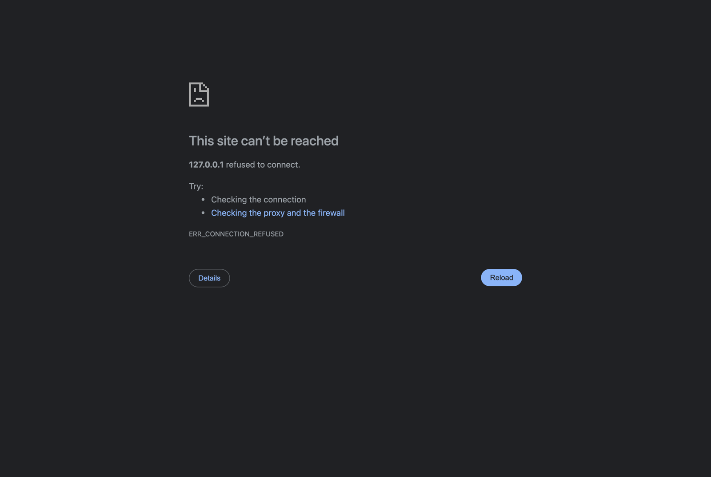

# xhs-minitool-preview

小红书小工具的本地预览模拟器。改 UI 不用每次打包、上传、扫码，在电脑浏览器里就能看。



## 能做什么

- **手机外框**：默认 iPhone 18 Pro（小灵动岛、超窄边框），还有 18 Pro Max、16/15、14/13 刘海、SE、Android 两档；状态栏黑字/白字可切。
- **小红书的返回、“我的”、分享按钮**：照真机画成灰色半透明圆底白图标，浮在小工具上层。`getWindowInfo().menuButtons` 返回的就是这三个按钮的位置（`back`、`me`、`share`），顶部要不要让开、让多少，一眼就能看出来。
- **模拟 `window.xhs`**：`getWindowInfo`、`getLaunchOptions`、`getStorage` / `setStorage` / `removeStorage`、`writeTempFile`、`saveImageToPhotosAlbum`（弹出保存的图）、`postNote`（弹出模拟发布页，标题超 20 字会报错）。
- **调用日志**：右侧列出每次容器调用和返回值。JS 报错、未处理的 Promise 拒绝，以及容器里用不了的能力（`window.open`、`prompt`、剪贴板、跨域 fetch、外链和下载链接）会标红。
- **自动刷新**：改了文件，手机画面自动重新加载。存储会保留，“清存储”可以从头再来。
- **多个小工具切换**：传一个装着多个小工具的目录，顶栏下拉切换，每个小工具的存储和状态栏设置分开记。

模拟环境只在预览时注入，你的源码和打包出的 zip 不受影响。

## 用法

需要 Node.js 20+，没有第三方依赖，不用 `npm install`。

```bash
git clone https://github.com/tankxu/xhs-minitool-preview.git
cd xhs-minitool-preview

# 先看看自带的示例
node scripts/preview.js examples --open

# 预览自己的小工具：单个目录（含 index.html），或装着多个小工具的父目录
node scripts/preview.js ~/my-minitools --open
```

- 父目录下会自动找 `*/src/index.html`、`*/dist/index.html`、`*/index.html`。
- 默认端口 5178，被占用自动 +1；`--port 8080` 指定端口。
- URL 后加 `#<目录名>` 直接打开某个小工具，例如 `http://127.0.0.1:5178/#demo`。
- 只监听 `127.0.0.1`，局域网其他设备访问不到。
- 顶栏最右的圆点：绿色表示已连上预览服务（改文件会自动刷新），红色表示服务停了。

## 作为 AI Agent 的 Skill 使用

仓库本身就是一个 Skill（见 [SKILL.md](SKILL.md)）。以 Claude Code 为例：

```bash
git clone https://github.com/tankxu/xhs-minitool-preview.git ~/.claude/skills/xhs-minitool-preview
```

之后跟 Agent 说“本地预览一下这个小工具”，它会启动预览并把地址给你。

## 局限

- 跑在桌面浏览器里，不是小红书客户端的 WebView。老内核下的 JS 语法、CSS 兼容问题这里看不出来，上线前仍要真机扫码。
- 按钮位置、安全区、灵动岛尺寸是按真机观感估的，不是官方数值。量到准确值后改 `assets/shell.html` 里的 `DEVICES` 和 `BTN*` 常量。
- iframe 里 `env(safe-area-inset-*)` 恒为 0，改为注入 `--safe-area-inset-*` 变量（和官方模拟器一样），顶部等于状态栏高度，返回/分享按钮在它下面 44px 高的一行里垂直居中，和真机一致；用 `var(--safe-area-inset-top, env(safe-area-inset-top))` 写法的小工具不用改代码就能正常显示。
- 不模拟 CSP、长按菜单禁用和真实分享面板。
- 平台官方模拟器是 `redapp dev`，需要更接近官方容器的行为时可以用它。

## 文件

```
scripts/preview.js    本地服务：找小工具、提供文件、注入模拟环境、监听改动
scripts/pack-skillhub.sh  打包发布到小红书 Skill 中心的目录
assets/shell.html     预览页：手机外框、按钮、状态栏、调用日志
assets/xhs-mock.js    在小工具里模拟 window.xhs
examples/demo/        示例小工具
SKILL.md              Agent Skill 说明
```

## 许可

[MIT](LICENSE.txt)
